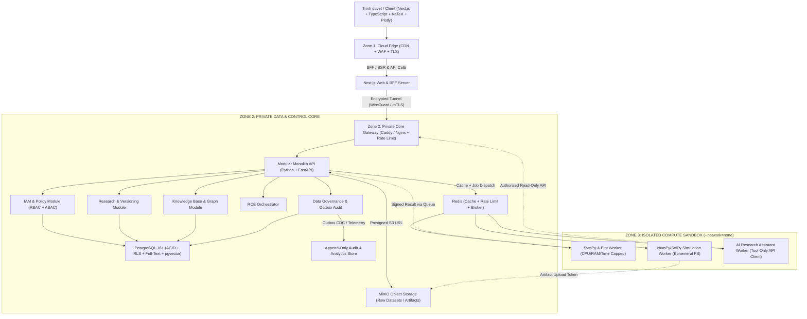
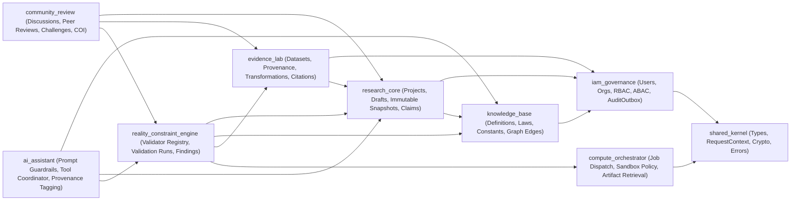
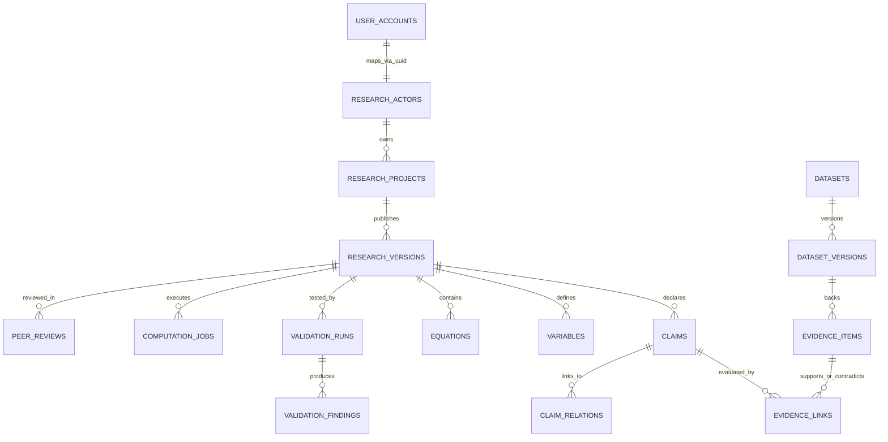

# REALITY SCIENCE — Kiến Trúc Hệ Thống, Dữ Liệu, Quản Trị & Đặc Tả API

---

## 1. Detailed System Architecture (Modular Monolith + Isolated Compute Workers)

Kiến trúc chia làm **3 vùng tin cậy (Trust Zones)** rõ rệt để cân bằng giữa tốc độ phát triển giai đoạn đầu và khả năng kiểm soát dữ liệu tuyệt đối:



### Ranh giới bất di bất dịch giữa các Vùng:
- **Zone 1 (Cloud Edge):** Chỉ phục vụ HTML/JS/CSS tĩnh, SSR công khai không nhạy cảm, chống DDoS. **Không lưu DB, không chứa secret khóa chính.**
- **Zone 2 (Private Data Core):** Toàn bộ PostgreSQL, MinIO, Redis, Audit Logs nằm trong mạng riêng. Mọi kết nối từ ngoài phải đi qua Tunnel mã hóa và xác thực tại Gateway.
- **Zone 3 (Isolated Compute Sandbox):** Không kết nối trực tiếp tới PostgreSQL Production, không có biến môi trường chứa mật khẩu DB/MinIO Root, không ra Internet (`--network=none` đối với worker tính toán toán học & code mô phỏng).

---

## 2. Module Dependency Map (Bản Đồ Phụ Thuộc Module)

Thiết kế theo **Modular Monolith** (trong `services/api/src/modules/`) tuân thủ quy tắc phụ thuộc một chiều (Acyclic Dependency) thông qua Domain Events và Service Interfaces:



> [!NOTE]
> **Quy tắc kiến trúc:** Không module nào được ghi trực tiếp vào bảng của module khác. Mọi thay đổi trạng thái quan trọng (`ResearchVersionPublished`, `DatasetUploaded`, `ValidationCompleted`) đều đi qua **Service Interface nội bộ** và phát sự kiện vào bảng `outbox_events` trong cùng transaction PostgreSQL.

---

## 3. Conceptual Database Schema (PostgreSQL 16+)

Thiết kế xoay quanh **3 trục cốt lõi**: (1) Tách PII khỏi danh tính nghiên cứu, (2) Phiên bản hóa bất biến theo Snapshot, (3) Khẳng định & Chứng cứ làm trung tâm (Claim-Centered Knowledge Graph).



### Chi tiết các nhóm bảng trọng yếu (Canonical Schema Design)

1. **Identity & Privacy Separation (Tách PII và Provenance):**
   - `user_accounts (id, email_hash, encrypted_email, password_hash, mfa_secret_enc, status, created_at)` — Dữ liệu nhạy cảm cá nhân, mã hóa và phân quyền chặt.
   - `research_actors (actor_id, user_account_id NULLABLE, display_handle, actor_type, is_anonymized)` — Bảng tham chiếu cho toàn bộ tác giả, phản biện, người tải dataset. Nếu user xóa tài khoản, `user_account_id` thành `NULL` và `display_handle` đổi thành `Contributor-#xxxx`, **không đứt lịch sử khoa học**.
   - `organizations`, `roles`, `permissions`, `project_memberships`, `conflict_of_interest_declarations`.

2. **Research Objects & Immutable Versioning:**
   - `research_projects (id, slug, owner_actor_id, org_id, visibility, created_at)`
   - `research_versions (id, project_id, version_number, publication_status, validation_status, evidence_maturity, title, abstract, assumptions_json, methodology_md, parent_version_id, content_hash, published_at, is_frozen)`
     - *Ràng buộc DB Trigger:* Khi `is_frozen = TRUE`, mọi lệnh `UPDATE` lên nội dung học thuật (`title`, `abstract`, `assumptions_json`, `equations`, `claims`) bị **từ chối ở tầng Database**; chỉ cho phép cập nhật trạng thái liên kết hoặc tạo `version_number` mới.
   - `variables (id, version_id, symbol, name, description, unit_expression, dimension_vector, is_new_concept)`
   - `equations (id, version_id, label, latex_raw, canonical_ast_json, sympy_expr, variable_refs_json)`

3. **Claim-Centered Knowledge Graph & Evidence:**
   - `claims (id, version_id, claim_code, statement, claim_type, status, uncertainty_notes)`
   - `claim_relations (id, source_claim_id, target_object_type, target_object_id, relation_type, justification, provenance_source, created_by_actor_id)`
     - `relation_type` ENUM: `SUPPORTS`, `CONTRADICTS`, `DERIVED_FROM`, `EXTENDS`, `REPRODUCES`, `REPLICATES`, `CHALLENGES`, `SUPERSEDES`, `DEPENDS_ON`, `RELATED_TO`.
   - `datasets (id, owner_actor_id, title, source_origin, collection_method, license, is_raw)`
   - `dataset_versions (id, dataset_id, version_tag, storage_uri, sha256_checksum, schema_json, parent_dataset_version_id, transformation_script_hash)` — Phân biệt rạch ròi dữ liệu thô (`parent_dataset_version_id IS NULL`) và dữ liệu đã xử lý.
   - `evidence_items` & `evidence_links` (gắn rõ loại chứng cứ: `DIRECT_EXPERIMENTAL`, `OBSERVATIONAL`, `MATHEMATICAL_PROOF`, `SIMULATION_OUTPUT`, `REPLICATION`, kèm độ bất định).

4. **Validation, Reproducibility & Immutable Audit:**
   - `validation_rulesets (id, domain, rule_code, version, description, applicability_conditions_json, formula_spec, tolerance_json)`
   - `validation_runs (id, version_id, ruleset_snapshot_json, overall_state, started_at, completed_at, triggered_by_actor_id)`
   - `validation_findings (id, run_id, layer, target_entity_type, target_entity_id, state, diagnostic_code, message, details_json)`
   - `computation_jobs (id, version_id, job_type, code_hash, inputs_hash, env_image_digest, seed, status, cpu_ms, peak_mem_mb, output_uri, error_log)`
   - `audit_events (event_id, prev_hash, event_hash, actor_id, org_id, request_id, ip_inet, action, resource_type, resource_id, before_hash, diff_json, created_at)` — Bảng Append-Only kèm chuỗi băm kiểm tra toàn vẹn.

---

## 4. Data Ownership & Governance Model

### 4.1. Ma trận Kiểm soát Quyền (RBAC + ABAC + PostgreSQL RLS)

| Vai trò / Ngữ cảnh | Draft cá nhân | Preprint / Public Version | Dữ liệu thô Nhạy cảm | Thay đổi RCE Ruleset | Audit Logs |
| :--- | :---: | :---: | :---: | :---: | :---: |
| **Visitor (Chưa đăng nhập)** | Không | Đọc bản Public | Theo License Dataset | Chỉ đọc | Không |
| **Research Owner / Author** | Đọc / Ghi / Đóng băng | Chỉ đọc (Muốn sửa phải tạo Version mới) | Quản lý phân quyền chia sẻ | Có thể đề xuất/khiếu nại | Xem log của chính dự án mình |
| **Verified Expert / Reviewer** | Không (trừ khi được mời) | Đọc + Tạo Peer Review & Challenge | Đọc bản được cấp phép thẩm định | Đọc & Đánh giá | Xem log thẩm định |
| **Org Admin** | Quản lý trong phạm vi Org | Quản lý chính sách xuất bản Org | Quản lý khóa & chính sách lưu trữ Org | Không | Xem Audit Log toàn Org |
| **Platform Moderator / Steward** | Không đọc nội dung riêng tư nếu không có Ticket | Chỉ gắn cờ/ẩn khi vi phạm nghiêm trọng (có biên bản) | Không | Đề xuất cập nhật theo hội đồng | Đọc log kiểm duyệt |
| **AI Assistant Service** | Chỉ đọc & Gợi ý (khi Owner gọi) | Chỉ đọc | Chỉ đọc mẫu được cấp phép rõ | Tuyệt đối không | Mọi hành động đều bị ghi log riêng `actor_type=AI` |

### 4.2. Thực thi PostgreSQL Row-Level Security (RLS)
Mỗi request vào API sau khi giải mã JWT sẽ mở transaction và thiết lập biến phiên cục bộ:
```sql
SET LOCAL app.current_actor_id = '<uuid>';
SET LOCAL app.current_org_id = '<org_uuid>';
SET LOCAL app.current_role = '<role>';
```
Chính sách RLS trên `research_projects` đảm bảo user chỉ thấy dự án `visibility = 'public'`, hoặc thuộc `owner_actor_id`, hoặc nằm trong `project_memberships` của mình.

### 4.3. Chính sách Chủ quyền & Di trú Dữ liệu (Portability)
- **Zero Lock-in:** Không sử dụng dịch vụ proprietary như AWS DynamoDB, Firebase hay Supabase-only extensions bắt buộc cho nghiệp vụ cốt lõi. Toàn bộ stack chạy chuẩn PostgreSQL + S3 API (MinIO) + OCI Container.
- **Export Chuẩn Khoa Học:** Mọi `ResearchVersion` có nút xuất thành gói `.zip` chuẩn mở gồm: `manifest.json` (JSON-LD/Schema), `paper.md` + LaTeX, `claims_graph.json`, `datasets/` (CSV/Parquet + SHA-256), `code/`, và `validation_report.json`.

---

## 5. Core API Specification (REST + Async Jobs)

Tất cả API đều đi qua `/api/v1`, chuẩn OpenAPI 3.1, bắt buộc trả về header `X-Request-ID` và tuân thủ schema Pydantic nghiêm ngặt:

| Nhóm API | Endpoint tiêu biểu | Mô tả & Quy tắc kiểm soát |
| :--- | :--- | :--- |
| **Research Lifecycle** | `POST /api/v1/research` | Tạo dự án mới (sinh Draft v0.1). |
| | `PUT /api/v1/research/{id}/draft` | Cập nhật nội dung Draft, biến, phương trình, claim. |
| | `POST /api/v1/research/{id}/versions` | Đóng băng Draft thành `ResearchVersion` bất biến, sinh `content_hash`. |
| **Variables & Math** | `PUT /api/v1/versions/{vid}/variables` | Khai báo ký hiệu toán học + đơn vị SI + chú thích vật lý. |
| | `POST /api/v1/compute/symbolic-check` | Đẩy biểu thức sang SymPy/Pint sandbox worker -> trả về `job_id` (HTTP `202 Accepted`). |
| **RCE Validation** | `POST /api/v1/versions/{vid}/validate` | Kích hoạt Reality Constraint Engine (chọn Lớp 1–6 phù hợp). |
| | `GET /api/v1/validation-runs/{run_id}` | Trả về từng `ValidationFinding` với state rõ ràng (`PASS`, `FAIL`, `WARNING`, `INSUFFICIENT_DATA`, `NEEDS_EXPERT_REVIEW`, `NOT_APPLICABLE`). |
| **Evidence & Graph** | `POST /api/v1/datasets/presign-upload` | Cấp Presigned URL tải file trực tiếp vào MinIO (kèm giới hạn dung lượng & MIME type). |
| | `POST /api/v1/claims/{cid}/evidence-links` | Gắn bằng chứng `SUPPORTS` / `CONTRADICTS` kèm nguồn & sai số. |
| | `GET /api/v1/graph/claims/{cid}/lineage` | Truy vết đồ thị khái niệm, giả định phụ thuộc và phản chứng. |
| **AI Assistant** | `POST /api/v1/ai/assist` | Chỉ chấp nhận ngữ cảnh từ Research Version; tự động gắn `provenance: "ai_assisted"` và chặn mọi yêu cầu ghi trực tiếp DB. |
| **Governance** | `GET /api/v1/admin/audit-events` | Truy vấn Audit Log theo `actor_id`, `resource_id`, `request_id` (Chỉ Admin/Auditor). |
