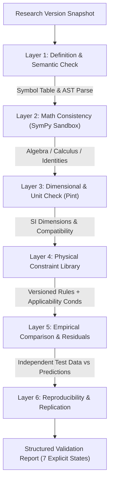
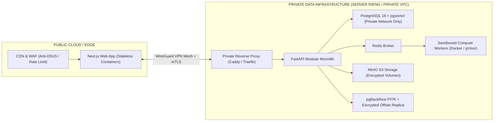

# REALITY SCIENCE — Kiểm Chứng Khoa Học (RCE), Bảo Mật, Triển Khai Hybrid, Rủi Ro & Kiểm Thử

---

## 1. Scientific Validation Architecture — Reality Constraint Engine (RCE)

**Reality Constraint Engine (RCE)** là bộ não tạo nên sự khác biệt của nền tảng. Nguyên tắc thiết kế: **Tất định trước (Deterministic First), Thẩm định Con người sau (Human Expert Second), Tuyệt đối không để AI phán chân lý.**

### Quy cách chi tiết 6 Lớp kiểm chứng

1. **Lớp 1 — Definition & Semantic Validation:**
   - Quét bảng `variables` và `equations` (AST).
   - Phát hiện: Biến dùng trong phương trình nhưng chưa khai báo; 1 ký hiệu gán 2 ý nghĩa mâu thuẫn trong cùng phiên bản; khái niệm vật lý mới chưa có *định nghĩa vận hành (operational definition)* hoặc hệ quả đo lường được -> gắn `WARNING` hoặc `FAIL`.
2. **Lớp 2 — Mathematical Consistency (SymPy Sandbox):**
   - Kiểm tra miền xác định, chia cho hằng số 0, đồng nhất thức biến đổi đại số (`simplify(lhs - rhs) == 0`), kiểm tra đạo hàm/tích phân các bước trung gian nếu người dùng khai báo dẫn xuất (`Derivation Steps`).
   - Phân biệt rạch ròi: **Lỗi toán học chứng minh được (`FAIL`)**, **Bất ổn định số (`WARNING`)**, và **Vượt ngưỡng độ phức tạp giải tích (`NEEDS_EXPERT_REVIEW`)**.
3. **Lớp 3 — Dimensional & Unit Validation (Pint):**
   - Ánh xạ mọi biến vào thứ nguyên chuẩn SI (`[length]`, `[mass]`, `[time]`, `[current]`, `[temperature]`, `[substance]`, `[luminance]`, hoặc `dimensionless`).
   - Chặn ngay các phép cộng/so sánh bất hợp pháp như `L + T` hoặc `exp(quantity_with_unit)` (hàm siêu việt chỉ nhận đại lượng không thứ nguyên!).
4. **Lớp 4 — Physical Constraint Library (Có phiên bản & Điều kiện biên):**
   - Mỗi quy luật (Bảo toàn năng lượng, Bảo toàn động lượng, Nhân quả tương đối tính, Nguyên lý Nhiệt động lực học 1 & 2...) là một bản ghi có `applicability_conditions` (ví dụ: *Hệ kín, phi tương đối tính, không có nguồn ngoài*).
   - Nếu mô hình thuộc hệ mở hoặc dùng xấp xỉ có khai báo rõ trong `assumptions`, RCE đánh dấu `NOT_APPLICABLE` hoặc `WARNING` thay vì tự động bác bỏ máy móc. Cho phép nhà nghiên cứu mở ticket **Thách thức điều kiện áp dụng của Constraint**.
5. **Lớp 5 — Empirical Validation:**
   - Bắt buộc phân tách `training_calibration_dataset_id` (dữ liệu dùng khớp tham số) và `evaluation_dataset_id` (dữ liệu độc lập) để chống ngụy tạo độ chính xác (*Overfitting / HARKing*).
   - Tính sai số dư (Residuals), độ bất định đo lường (Error Bars), và so sánh định lượng với mô hình chuẩn hiện hành (Baseline Model Comparison).
6. **Lớp 6 — Reproducibility & Replication:**
   - Lưu **Reproducibility Bundle**: `version_id` + `code_sha256` + `container_image_digest` + `requirements_lock` + `input_dataset_sha256` + `random_seed`.
   - Phân biệt `Reproduced` (chạy lại đúng môi trường cũ ra cùng kết quả) và `Replicated` (nhóm độc lập dùng dữ liệu/phương pháp khác kiểm chứng lại).

### Bảng Trạng thái Đánh giá Bắt buộc (7 States)
Mỗi check chỉ trả về đúng 1 trong 7 trạng thái: `PASS`, `FAIL`, `WARNING`, `NOT_APPLICABLE`, `INSUFFICIENT_DATA`, `NEEDS_EXPERT_REVIEW`, `NOT_YET_TESTED`. **Hệ thống không bao giờ gộp 7 trạng thái này thành một nhãn đơn giản "Đúng" hay "Sai".**

---

## 2. Security & Isolated Execution Architecture

Vì người dùng nạp biểu thức toán, file dataset và kịch bản mô phỏng, bảo mật phải được thiết kế theo hướng **Zero-Trust Compute**:

1. **Cô lập tuyệt đối môi trường chạy Toán & Mô phỏng (Compute Sandbox):**
   - Không chạy `eval()`, `exec()`, hay `sympy.parsing` trên Web API process.
   - Worker chạy trong Container cô lập (`--network=none`, `--read-only`, `--cap-drop=ALL`, user không phải root).
   - Thiết lập **Hard Limits** trên từng Job: `Timeout = 10s` (SymPy check) / `120s` (Simulation MVP), `Memory = 512MB–2GB`, `CPU Quota = 1 vCPU`, chống *Symbolic Bomb* (ví dụ giới hạn độ sâu AST và số hạng khai triển đa thức).
2. **Bảo mật AI Assistant (Anti-Prompt-Injection & Anti-Hallucination):**
   - AI Agent chỉ giao tiếp với hệ thống qua tập API tối thiểu (Read-only Research/Knowledge + Trigger Job tính toán).
   - Tuyệt đối không có quyền SQL trực tiếp, không có quyền ghi vào `validation_runs`, `audit_events`, hay `research_versions` đã khóa.
3. **Bảo mật Dữ liệu & Tầng Mạng:**
   - **Upload Malware Mitigation:** File upload vào MinIO đi qua Presigned URL có giới hạn dung lượng, kiểm tra Magic Bytes, lưu ở Bucket cách ly (`quarantine-bucket`) -> quét định dạng/antivirus trước khi chuyển sang `verified-datasets-bucket`.
   - **Envelope Encryption:** Dữ liệu cá nhân (email, khóa MFA) và secret tích hợp được mã hóa AES-256-GCM trước khi ghi xuống Postgres.
   - **Tamper-Evident Audit Chain:** Mỗi bản ghi `audit_events` lưu `event_hash = SHA256(prev_hash || actor_id || action || resource_id || diff_json || timestamp)`, giúp phát hiện tức thì nếu có can thiệp trái phép trực tiếp vào ổ đĩa DB.

---

## 3. Hybrid Deployment Architecture (Cloud Edge + Private Core)

### Quy tắc Triển khai & Chống Phụ thuộc Nhà cung cấp (Vendor Independence)
- **Infrastructure as Code (IaC):** Toàn bộ hạ tầng Private Core mô tả bằng `Docker Compose` (giai đoạn đầu) / `Terraform + Kubernetes (k3s)` (khi mở rộng), dễ dàng mang toàn bộ sang VPS khác hoặc máy chủ vật lý On-Premise.
- **Lưu trữ & Phục hồi Dữ liệu (Backup 3-2-1):**
  - PostgreSQL bật WAL Archiving liên tục (`pgBackRest`) cho phép khôi phục về **đúng từng giây (PITR)**.
  - MinIO bật Object Versioning + đồng bộ bất đồng bộ sang bản sao lưu mã hóa ngoài site chính.
  - Bắt buộc chạy kiểm thử phục hồi tự động (**Restore Drill**) mỗi tuần một lần trên môi trường Staging.

---

## 4. Risk Register (Sổ Đăng Ký Rủi Ro)

| Nhóm | Rủi ro cụ thể | Mức độ | Biện pháp Phòng ngừa & Giảm thiểu |
| :--- | :--- | :---: | :--- |
| **Khoa học** | RCE từ chối nhầm lý thuyết mới hợp lệ vì áp dụng quy luật vật lý sai điều kiện biên. | **Cao** | Mọi Constraint bắt buộc khai báo `applicability_conditions`; hỗ trợ `NOT_APPLICABLE` và quy trình khiếu nại ràng buộc công khai. |
| **Khoa học** | AI Assistant bịa trích dẫn, tự bịa số liệu hoặc gắn mác "đã chứng minh". | **Cao** | Cấm AI tự ghi bảng kiểm chứng; bắt buộc trích dẫn `source_id` có thật trong DB; gắn nhãn phân biệt rõ `ai_assisted`. |
| **Bảo mật** | Người dùng gửi biểu thức SymPy/script gây DoS (Symbolic Bomb) hoặc thoát sandbox (RCE). | **Rất Cao** | Chạy SymPy/SciPy hoàn toàn tách biệt trong container `--network=none`, giới hạn độ sâu AST, RAM, CPU và timeout cứng. |
| **Dữ liệu** | Mất tính nhất quán giữa dữ liệu sửa và Audit Log, hoặc dev vô tình làm lộ dữ liệu dự án nháp. | **Cao** | Dùng **Transactional Outbox Pattern** cho Audit Log; bật **PostgreSQL RLS** ở tầng Database cho mọi bảng theo `owner_id`/`org_id`. |
| **Vận hành** | Nghẽn cổ chai mạng qua Tunnel Hybrid khi AI/Simulation cần đọc dataset lớn. | **Trung bình** | Đặt Compute Workers ngay trong Private Core cạnh MinIO ở giai đoạn 1–3; chỉ chuyển worker GPU nặng lên Cloud qua Snapshot nén khi thực sự cần. |
| **Sản phẩm** | Ôm đồm quá nhiều phân hệ (3D, Knowledge Graph, Vũ trụ học) ngay từ MVP dẫn tới dự án chết yểu. | **Rất Cao** | Tuân thủ nghiêm ngặt Stage 0–2: Chỉ hoàn thiện **Research Versioning + Toán SymPy + Đơn vị Pint + Cơ học cổ điển** trước khi mở phân hệ mới. |

---

## 5. Test Strategy & Acceptance Criteria (Chiến Lược Kiểm Thử)

1. **Kiểm thử Toàn vẹn Toán học & Thứ nguyên (Golden Scientific Suite):**
   - Bộ >150 ca kiểm thử chuẩn xác định trước kết quả: đạo hàm, tích phân, phương trình vi phân cơ bản, kiểm tra thứ nguyên SI (bao gồm phát hiện lỗi tinh vi như `rad` vs `sr`, cộng đại lượng khác thứ nguyên).
2. **Kiểm thử Bảo mật & Sandbox (Security & Chaos Tests):**
   - Kiểm thử các payload Symbolic Bomb (lũy thừa lồng nhau, khai triển Taylor bậc cực lớn) -> phải bị ngắt đúng `timeout` mà API chính vẫn phản hồi dưới 100ms.
   - Kiểm thử xâm nhập chéo (Cross-tenant/Draft IDOR) -> PostgreSQL RLS phải chặn 100% ở tầng DB.
3. **Kiểm thử Bất biến Dữ liệu & Tái lập (Versioning & Reproducibility Tests):**
   - Xác minh không thể `UPDATE` nội dung một `ResearchVersion` đã đóng băng (`is_frozen=TRUE`).
   - Chạy lại một `ComputationJob` cùng input + seed + container digest phải cho ra cùng `output_sha256`.
4. **Kiểm thử Phục hồi Thảm họa (DR Verification):**
   - Khôi phục tự động PostgreSQL từ bản WAL backup vào container sạch và chạy lại bộ test toàn vẹn khóa ngoại + hash-chain Audit Log.
5. **End-to-End Acceptance Criteria cho MVP:**
   - Người dùng đăng ký -> tạo dự án -> khai báo biến `v (m/s)`, `t (s)`, `d (m)` -> viết `d = v * t` -> chạy RCE đạt `PASS` (đạt cả Semantic, SymPy, Pint) -> sửa sai thành `d = v + t` -> chạy RCE trả `FAIL` đúng lỗi thứ nguyên -> xuất bản `v1.0` -> sửa tiếp `v1.1` trong khi `v1.0` và báo cáo cũ vẫn nguyên vẹn kèm Audit Trail đầy đủ.
